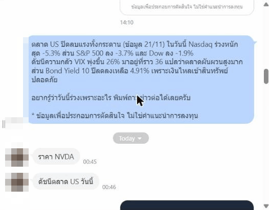
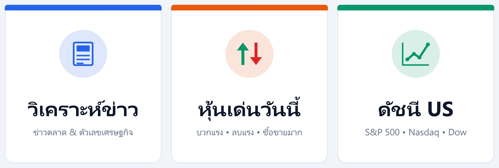

<p align="center">
  
</p>

<h1 align="center">LINE OA Stock & News Bot</h1>

<p align="center">
  <b>US-market assistant for LINE</b> — live index cards, today's movers and Thai-language news analysis, one tap away in a rich menu.
</p>

<p align="center">
  
  
  
  
</p>

A LINE Official Account chatbot that follows the US stock market and answers in Thai. Claude decides which data to fetch through tool use; every number comes from a live market endpoint, never from the model. Replies arrive as LINE Flex cards plus a short Thai summary.

## Demo

<p align="center">
  
  <br>
  <sub>Real replies from the running bot, recorded from the LINE OA chat view (the user's avatar is blurred). Index card → price cards → news analysis → today's movers.</sub>
</p>

### Rich menu

<p align="center">
  
</p>

| Button | Sends | What the bot does |
|---|---|---|
| **วิเคราะห์ข่าว** (News analysis) | `วิเคราะห์ข่าวตลาด US วันนี้` | Pulls market news and economic-data news (CPI, jobs, Fed) from the last 2 days, picks the 3–5 that matter, translates and summarises them in Thai, and says why the market is watching each one |
| **หุ้นเด่นวันนี้** (Today's movers) | `หุ้นเด่นวันนี้` | Flex card of top gainers, losers and most-active US stocks (5 each), plus news context for the biggest movers |
| **ดัชนี US** (US indices) | `ดัชนีตลาด US วันนี้` | Flex card with S&P 500, Nasdaq, Dow Jones, Russell 2000, VIX and the US 10-year yield |

Free-text questions work too: `ราคา AAPL`, `ข่าว NVDA ล่าสุด`, `ราคา micron`.

## Overview

### Why "information, not advice"?

Market data in a chat app reaches people who may act on it. The bot is built to **inform, not recommend**:

- Prices and indices come from Yahoo Finance endpoints and are rendered straight into cards. The model only summarises them.
- "Today's movers" means stocks that moved or traded the most, not picks.
- Buy / sell / hold questions and price predictions are declined.
- Every card and every answer that carries data ends with a "not investment advice" line.

## Features

- **Claude tool use**: four strict tools (`get_quote`, `market_overview`, `top_movers`, `get_news`) in a manual tool loop, with a cached system prompt.
- **Flex cards**: price cards (green up / red down, day high/low, update time), index list and movers list, sent as a carousel when there are several.
- **News**: Google News RSS (English for US news, Thai available), limited to the last 2 days.
- **LINE details**: webhook signature check (HMAC-SHA256), loading animation while Claude works, quick-reply chips, greeting on follow.
- **One-click run**: `start_bot.bat` starts a Cloudflare quick tunnel, points the LINE webhook at it, tests it and serves.
- **Assets as code**: `make_images.py` draws the rich menu and profile image with plain vector shapes, no stock icons.

## Architecture

```
bot.py            # Everything: market data, Flex cards, Claude tools, LINE webhook, CLI commands
make_images.py    # Draws rich_menu.jpg and profile/profile_640.png
start_bot.bat     # Double-click: tunnel + webhook + server (Windows)
rich_menu.jpg     # 2500x843 compact rich menu (3 buttons)
profile/          # LINE profile picture and cover
docs/demo.gif     # Demo recording
```

Request flow:

```
LINE app ──> LINE Platform ──webhook──> Cloudflare tunnel ──> Flask /callback
                                                                 │ verify signature, ack fast
                                                                 ▼
                                                       Claude (tool use loop)
                                                    ┌────────┼──────────┐
                                              Yahoo chart  Yahoo screener  Google News RSS
                                                    └────────┼──────────┘
                                                                 ▼
                                              Reply API: Flex cards + Thai summary
```

## Getting Started

```bash
git clone https://github.com/chestertood/line-oa-stock-news-bot.git
cd line-oa-stock-news-bot
pip install -r requirements.txt
copy .env.example .env   # then fill in the three keys
```

1. Create a LINE Official Account, enable **Messaging API**, then copy the **Channel secret** and issue a **Channel access token** in the LINE Developers Console.
2. Put them, plus your `ANTHROPIC_API_KEY`, in `.env`.
3. In OA Manager → Response settings: **Webhook on**, **Auto-response off**.
4. Install [cloudflared](https://developers.cloudflare.com/cloudflare-one/connections/connect-networks/downloads/) and run `start_bot.bat` (or `python bot.py up`).
5. Upload `rich_menu.jpg` in OA Manager (compact, 3 columns) with text actions from the table above, or run `python bot.py richmenu`.

### Commands

| Command | What it does |
|---|---|
| `python bot.py up` | Tunnel + set webhook + serve (what `start_bot.bat` runs) |
| `python bot.py` | Webhook server only, on :8000 |
| `python bot.py webhook https://xxxx.trycloudflare.com` | Point the LINE webhook at a tunnel URL and test it |
| `python bot.py chat` | Chat in the terminal, no LINE needed |
| `python bot.py selftest` | Offline checks, no network or API calls |
| `python bot.py richmenu` | Upload `rich_menu.jpg` as the default rich menu through the API |

The model defaults to `claude-opus-5-5` at low effort; set `MODEL` in `.env` to change it.

## Limitations

- Quick tunnels get a new URL on every start, which is fine for demos. For 24/7 use, deploy to a server or use a named tunnel.
- Conversation history is kept in memory per user and resets on restart.
- Yahoo Finance endpoints are unofficial and may change or rate-limit.

## Disclaimer

Data is for information only and is not investment advice.

## License

MIT
